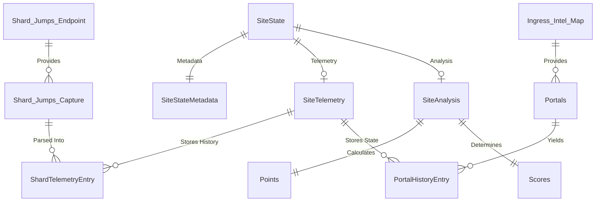

# Conceptual Data Schema

This document illustrates the structural relationships between the domain models used across the `ingress-events-core` project. Rather than defining strict property structures (which are maintained definitively in the TypeScript types), this schema visualizes how raw data flows from capture into final event standings.

## Incoming Data Streams

To understand the domain schema, it is critical to distinguish the two fundamentally different raw data feeds that enter the system:

1. **The Point-in-Time Snapshot (IITC Map Scans)**
   * **Nature**: A direct snapshot of the map state at the moment of capture.
   * **Format**: It provides spatial data regarding static features attached to portals, specifically ornaments (e.g., Anomaly portals before an event, Battle Beacons during an event).
   * **Challenge**: Generates high-frequency, duplicated point-in-time data if captured constantly.

2. **The Historical Event Stream (Niantic Endpoint)**
   * **Nature**: An historical, chronological view of recent events.
   * **Format**: It provides spatial movement data (shard jumps). Each artifact/fragment represents a site, providing a complete historical view of the site from the present moment backward into the past.
   * **Challenge**: Disconnected from the real-time, instantaneous map state.

While both streams provide *spatial data*, they are completely different in their temporal orientation (Snapshot vs. Historical). Because of this, our domain models must respect their unique structures rather than forcing them into a single, unified format during the observation phase.

### Observation Strategies

Because of the differences in the incoming data streams, the observation layer handles data retention differently:

- **Point-in-Time Snapshots (Wipe-and-Replace)**: Since IITC Map Scans represent the absolute state of the map at the moment of capture, the system supports a manual "wipe-and-replace" feature via the observer plugin. Rather than automatically tracking removals, users can manually clear all pre-event ornaments for a site and replace them entirely with a fresh scan. This prevents the need for complex state-diffing or calculating "removed" events.
- **Historical Event Stream (Immutable Append)**: Since Shard Jumps are chronological events, they are immutably appended to the shard's history log.

**Note on Ornaments & Beacons:**
The system uses a data-driven approach for identifying portal features. Rather than hardcoding specific ornament IDs, the system filters ornaments based on **tags** defined in `event_blueprints.json`. Common categories include:
- `target`: Ornaments representing shard targets (RES/ENL).
- `battle-beacon`: Ornaments related to active or completed Battle Beacons (e.g., `peBB_BATTLE_RARE`).
- `pre-event`: Ornaments used for site identification before an event goes live.
- `recursive`: Bonus multipliers or other special modifiers.

## Entity Relationship Flow
The data models map to the classic data lifecycle and are unified within the **SiteState** container.

## Temporal Data Standards

- **Domain Models & Resolved Timelines (`SiteState`, `SiteTimeline`)**: All timestamps are normalized to **Epoch Milliseconds** (13-digit Unix `number`) across metadata, portal/shard telemetry, jump windows, and wave schedules.
- **Ingestion & Config Boundaries**: External formats are normalized during ingestion and config compilation — e.g. ISO `ZonedDateTime` strings in `season_geocode.json`, stringified ms in Niantic `ShardJumpCapture` payloads, and epoch-second `exportedAt` fields in `SiteDiscovery` / `SiteTargetPortals`.

## Layer Definitions

### 1. Root Container: SiteState
The `SiteState` is the primary domain entity representing the complete lifecycle of a single event site. It acts as the container for everything known about that site.

- **metadata**: Identifying keys (`siteId`, `seasonId`) and `lastUpdated` timestamp (`SiteStateMetadata`).
- **telemetry**: The raw processed state and historical jump telemetry (`SiteTelemetry`).
- **analysis**: The enriched results, point tallies, and faction scores (`SiteAnalysis`).

### 2. Telemetry Layer (SiteTelemetry)
The telemetry layer defines the document model of what has been observed on the map.

- **ShardTelemetryEntry**: Chronological record of a shard movement or spawn action.
- **PortalHistoryEntry**: Captures chronological indicators like `battle-beacon`, `target`, and `pre-event` ornaments exactly as rendered on the portal network.

### 3. Analysis Layer (SiteAnalysis)
The analysis layer enriches the stored telemetry data to produce rule-based standings and wave breakdowns.

- **WaveState**: A snapshot of the site's competitive state at a specific wave.
- **Points**: Raw accounting totals and scoring rules breakdown.
- **Scores**: The final verdict or rule-based point allocation (`seasonPointsResult`).

---

### **Related Documentation**
- [Architecture & Lifecycle](./Architecture.md)
- [Game Mechanics](./mechanics/README.md)
