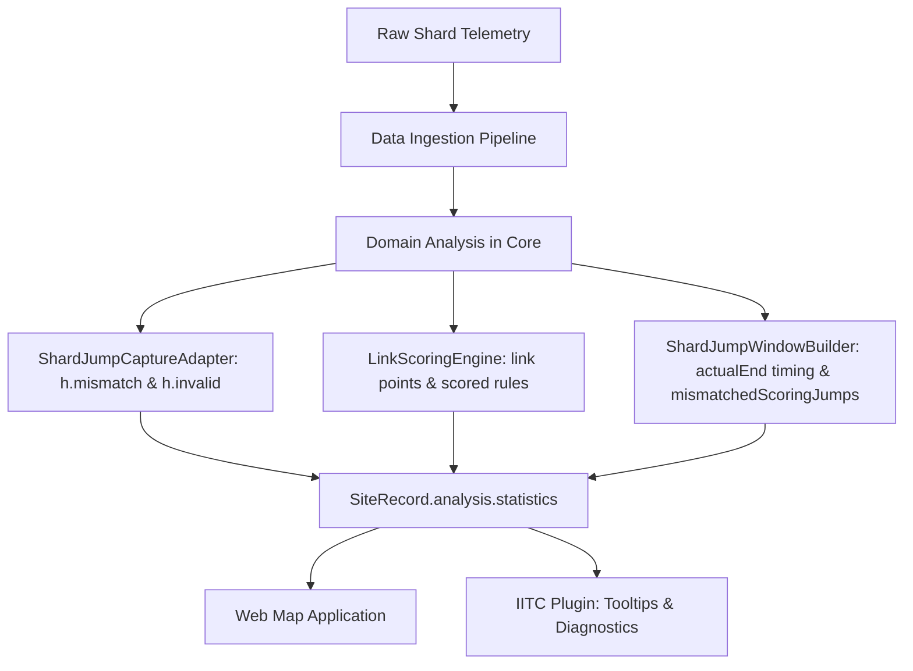

# Validation and Diagnostics Architecture

This document defines the data validation, telemetry diagnostics, and anomaly tracking architecture within the `@ingress-shards/ingress-events-core` library.

---

## 1. Architecture Overview

Validation, sequence continuity verification, link alignment analysis, and timing metrics are evaluated natively within the core data ingestion and analysis pipeline (Stages 3 & 5). 

Telemetry anomalies are modeled directly on domain entities and aggregated into canonical site statistics ([`SiteRecord.analysis.statistics`](../../src/sites/Site.ts)):

---

## 2. Canonical Telemetry & Site Statistics: `TelemetryStatistics`, `WaveStatistics`, `SiteStatistics`

Statistical domain models are defined in [`src/sites/Statistics.ts`](../../src/sites/Statistics.ts):
- **`TelemetryStatistics`**: Base interface modeling common physical event metrics (`shards.moving`, `shards.nonMoving`, `links`, `paths`, and `targets`).
- **`WaveStatistics`**: Lean wave-scoped statistics (`WaveState.statistics`) capturing physical metrics for an individual wave without diagnostic rollups.
- **`SiteStatistics`**: Comprehensive site-level statistics ([`SiteRecord.analysis.statistics`](../../src/sites/Site.ts)) extending `TelemetryStatistics` with canonical diagnostic anomaly rollups.

The `StatisticsCalculator` evaluates `SiteStatistics` unconditionally for **all sites** (including single-wave Skirmishes and multi-wave Anomalies):

| Property | Type | Scope | Description |
| :--- | :--- | :--- | :--- |
| `shards.moving` | `number` | Wave & Site | Count of shards that performed at least one movement action (`link` or `jump`). |
| `shards.nonMoving` | `number` | Wave & Site | Count of shards with only spawn actions or no recorded movement events. |
| `links` | `number` | Wave & Site | Total unique links traversed by shards across the context. |
| `paths` | `number` | Wave & Site | Total topological paths established between portal pairs. |
| `targets` | `number` (optional) | Wave & Site | Total active target portals observed in the context (omitted if 0). |
| `mismatchedMoves` | `number` (optional) | Site Only | Total shard movements that experienced faction/portal alignment mismatches (omitted if 0). |
| `invalidActions` | `number` (optional) | Site Only | Total shard actions executed from an invalid/discontinuous origin (omitted if 0). |
| `extendedJumpWindows` | `number` (optional) | Site Only | Total jump windows with duration exceeding `STANDARD_JUMP_WINDOW_DURATION_MS` (omitted if 0). |

---

## 3. Native Anomaly Tracking in Domain Models

All diagnostic anomalies are tracked natively on domain entities:

### 1. Link Alignment Mismatches
- **Domain Telemetry:** [`ShardHistoryEntry.mismatch`](../../src/sites/Shard.ts) (`{ originAlign?: Alignment; destAlign?: Alignment }`)
- **Site Aggregation:** `SiteRecord.analysis.statistics.mismatchedMoves` (`number`)
- **Window Scoring Aggregation:** [`ShardJumpWindow.mismatchedScoringJumps`](../../src/sites/Site.ts) (`Partial<Record<FactionId, number>>`)
- **Condition:** Evaluated during shard jump capture and scoring when the faction controlling a link differs from the faction alignment of either endpoint portal. 
  - Scored movements with alignment mismatches are aggregated by faction in `ShardJumpWindow.mismatchedScoringJumps`.
  - The aggregate count of all movements with mismatches (including unscored jumps, sub-threshold distances, and neutral links) is recorded in `SiteRecord.analysis.statistics.mismatchedMoves`.
- **Presentation:** Rendered in jump window tooltip breakdown tables as "Mismatched Jumps".

### 2. Invalid Shard Sequences & Discontinuous Origins
- **Domain Model:** [`ShardHistoryEntry.invalid`](../../src/sites/Shard.ts) (`boolean`)
- **Site Aggregation:** `SiteRecord.analysis.statistics.invalidActions` (`number`)
- **Condition:** Evaluated during shard history construction when an action's origin portal ID does not match the shard's last-known location portal ID.
- **Presentation:** Highlighted in shard path inspector and diagnostic tooltips.

### 3. Actions Outside Jump Window (Extended Windows)
- **Domain Model:** [`ShardJumpWindow`](../../src/sites/Site.ts) (`scheduledStart: number`, `actualEnd: number`, `actionCount: number`)
- **Duration Calculation:** Derived on-demand via `actualEnd - scheduledStart`.
- **Site Aggregation:** `SiteRecord.analysis.statistics.extendedJumpWindows` (`number`)
- **Threshold:** Windows where `(actualEnd - scheduledStart) > STANDARD_JUMP_WINDOW_DURATION_MS` (60,000 ms / 1 minute).
- **Presentation:** Jump window chips and table rows receive warning styling indicating extended server processing.

### 4. Jump Window Action Tracking
- **Domain Model:** [`ShardJumpWindow.actionCount`](../../src/sites/Site.ts) (`number`)
- **Action Scope:** Shard action semantics are governed by [`FlashShards.md`](../mechanics/FlashShards.md) (`spawn`, `link`, `jump`, `no move`, `despawn`). Action windows (`ShardJumpWindow`) strictly represent scheduled jump opportunity windows; administrative spawn and despawn windows are excluded.
- **Telemetry Transparency:** Rather than calculating fragile discrepancy flags (which produce false positives during sequential Shard Storm cycles or active in-flight events), observed actions are recorded directly in `actionCount` for transparent inspection in tooltips and breakdown tables.

---

## 4. Summary Rollups

All site-wide diagnostic anomaly counts (`invalidActions`, `mismatchedMoves`, `extendedJumpWindows`) are aggregated directly within `SiteRecord.analysis.statistics` in `gen/data/*.json`. 

Consumers (such as the Web Map Application and IITC Plugin) can perform $O(1)$ site health checks from top-level metadata without having to deserialize or traverse individual waves and jump windows.
